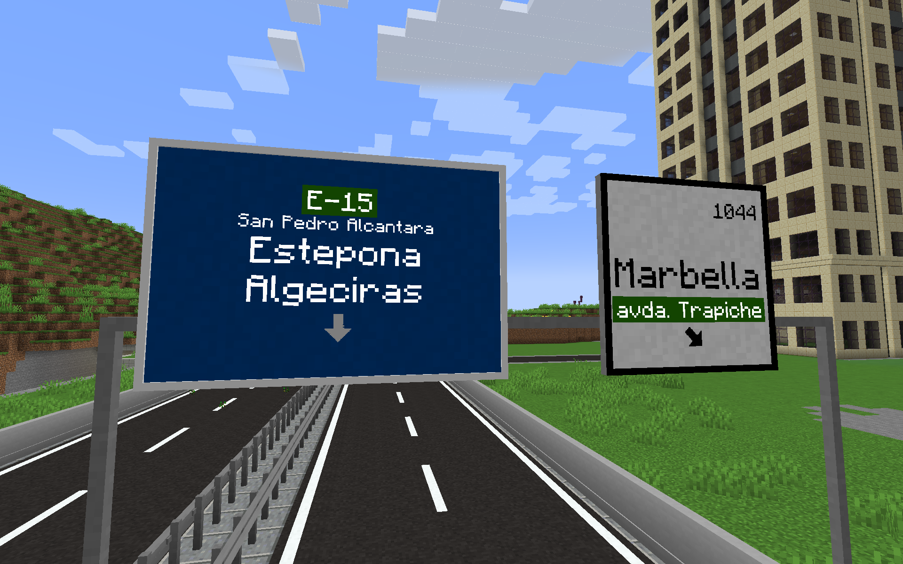
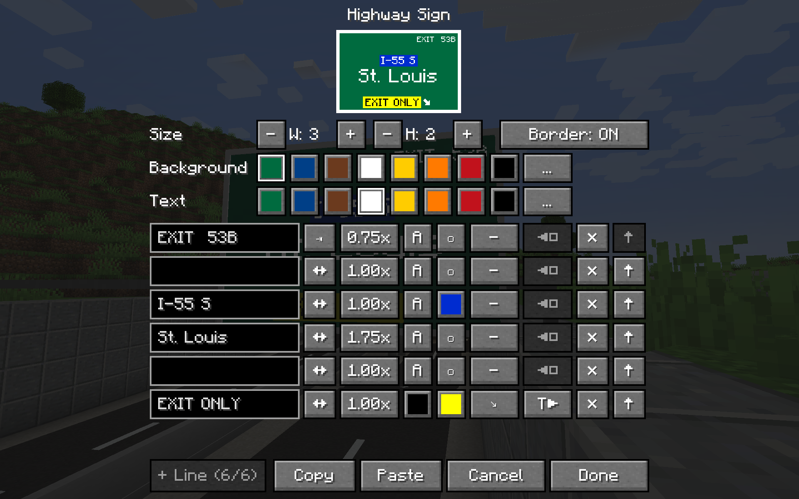

# Highway signs addon for TrafficCraft

An addon for [TrafficCraft](https://modrinth.com/mod/trafficcraft).

This addon adds customizable highway signs to TrafficCraft mod. Add custom text in different sizes, change colors and backgrounds, add arrows and more. From 1x1 to 8x4 blocks size. 

- Requires: TrafficCraft `1.20.1-1.1.3` or newer (including `1.2.0` betas). Architectury API, DragonLib and Forge Config API Port come with TrafficCraft, so they don't need to be installed separately. Fabric also needs Fabric API.


## Screenshots




## How to use
1. Craft or take the **Highway Sign** from TrafficCraft's creative tab.
2. Place it on the side of a TrafficCraft sign post. The sign must have a post directly behind it:
    - on a vertical post, any side works;
    - on a horizontal post (gantry), only the two sides across it.
3. Right-click the sign with a **wrench** to open the editor. In the editor you can set:
    - size, from 1×1 to 8×4 blocks (width × height);
    - colors and lines: 3 lines per block of height, 48 characters per line;
    - per-line arrows, alignment, text size and colors;
    - copy/paste of a whole sign.
4. Changes apply when you press **Done**. At least one block of the resized sign must still be on a post.

Breaking any block of a sign removes the whole sign.

## Development

Use **JDK 17** for the game.
```sh
./gradlew build               # jars in fabric/build/libs and forge/build/libs
./gradlew :fabric:runClient   # dev client (also :forge:runClient)
./gradlew :fabric:runServer   # dev server (accept the EULA in fabric/run/eula.txt yourself)
```

TrafficCraft comes from the Modrinth maven by version ID. To update it:
1. Change `trafficcraft_fabric_version` and `trafficcraft_forge_version` in `gradle.properties`. The IDs are listed at `https://api.modrinth.com/v2/project/trafficcraft/version`.

The addon does not use DragonLib's API, only Architectury (compiled against `9.1.12`, the version bundled with TrafficCraft's DragonLib). DragonLib is only a dev runtime dependency (`modLocalRuntime`), because TrafficCraft needs it. Keep it that way: TrafficCraft 1.1.x ships DragonLib 2.x and 1.2.x needs DragonLib 3.x, and only one can be loaded.


